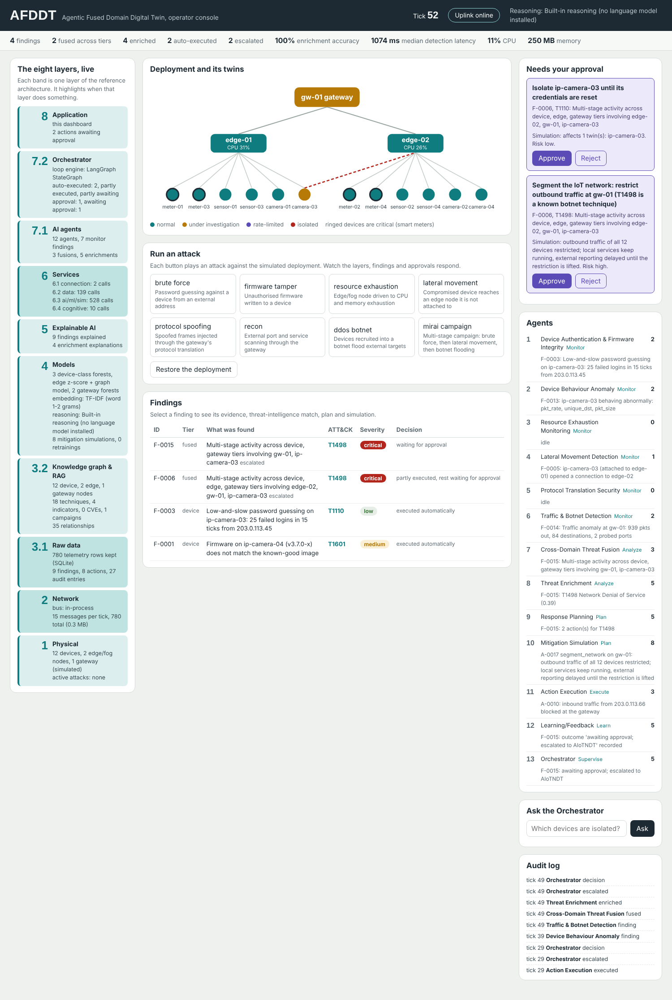

# AFDDT: Agentic Fused Domain Digital Twin

This folder is the working implementation of the system described in Chapter Three of the dissertation. It runs on an ordinary laptop with no extra hardware.

**What you will see.** A web page (the operator dashboard) opens in your browser. It shows:

- all eight layers working, live;
- the network of devices, edge nodes and the gateway, coloured by status;
- buttons that launch attacks;
- findings with their MITRE ATT&CK match;
- actions waiting for your approval;
- what each of the 13 agents is doing.

There is no APK. The dashboard is a web page, and step 7 shows how to open it on your phone as well.



---

## Part A: Set up (once)

### Step 1. Install Python

1. Go to https://www.python.org/downloads/ and install **Python 3.11 or 3.12**.
2. On Windows, tick **"Add python.exe to PATH"** on the first installer screen.
3. Check it worked: open a new terminal (on Windows, PowerShell) and type `python --version`. You should see `Python 3.11.x` or `Python 3.12.x`.

### Step 2. Install VS Code and the Python extension

1. Install VS Code from https://code.visualstudio.com/.
2. Open it, click the Extensions icon on the left (four squares), search for **Python** (by Microsoft) and click Install.

### Step 3. Open the project

1. Unzip `AFDDT.zip` somewhere simple, for example `Documents\AFDDT`.
2. In VS Code: **File > Open Folder** and choose the `AFDDT` folder (the one that contains `run.py`).
3. If VS Code asks whether you trust the authors, choose **Yes**.
4. Open a terminal inside VS Code: **Terminal > New Terminal**. Every command below is typed into this terminal.

### Step 4. Create a virtual environment

A virtual environment is a private copy of Python for this project, so nothing clashes with other work.

**Windows:**
```
python -m venv .venv
.venv\Scripts\activate
```
If PowerShell says running scripts is disabled, run this once, then repeat the second line:
```
Set-ExecutionPolicy -Scope CurrentUser RemoteSigned
```

**macOS or Linux:**
```
python3 -m venv .venv
source .venv/bin/activate
```

You will see `(.venv)` at the start of the terminal line. That means it is active. Each time you open a new terminal later, run the activate line again.

### Step 5. Install the libraries

```
pip install -r requirements.txt
```
This takes a few minutes and needs internet once. After it finishes, the system runs offline.

### Step 6. Check every layer works

```
python scripts/self_test.py
```
It builds the system, watches 120 seconds of normal traffic (there should be no false alarms), then plays each of the eight attacks. It takes about a minute. It should end with:
```
All layers working.
```

---

## Part B: Run it and show it working

### Step 7. Start the AFDDT

```
python run.py
```
Your browser opens at **http://127.0.0.1:8000**. To stop the system, click the terminal and press **Ctrl+C**.

- **On your phone:** run `python run.py --lan`, connect the phone to the same Wi-Fi, and open `http://<your laptop's IP address>:8000`. On Windows, `ipconfig` shows the IP address under "IPv4 Address".
- **From VS Code's Run menu:** you can also press **F5** and pick **"2. Run AFDDT + dashboard"**.

### Step 8. A demonstration you can give (about five minutes)

Run these in order. Each one shows a part of the design.

| Do this | What you will see | What it proves |
|---|---|---|
| Wait 20 seconds | Tick count rises; Layers 1, 2, 3.1 and 6 update; no findings | The twins track normal traffic without false alarms |
| Click **brute force** | Finding T1110; known indicator matched; source blocked and device isolated **automatically** | UC1: autonomous response (Monitor, Analyze, Plan, Execute) |
| Click **firmware tamper** (if it hits a smart meter) | Re-flash waits under **Needs your approval** because the meter is critical | NFR6: high-risk actions need human sign-off |
| Click **mirai campaign** and wait about 40 seconds | A **fused** finding; open it to see the attack chain T1110 then T1021 then T1498, linked to the demo campaign; network segmentation waits for approval; escalated to the AIoTNDT | UC2 and UC3: cross-domain fusion and threat-intelligence enrichment drive the response |
| Click **Approve** on a card | The device turns red (isolated) and the attack traffic stops | The Execute stage closes the loop on the physical asset |
| Click **Uplink online** to switch it offline | The reasoning engine switches to the local model, or to built-in reasoning | NFR2: graceful degradation without connectivity |
| Open a finding and click **Mark as false positive** | Learning/Feedback agent retrains the device-class model | The Learn stage (FR9) |
| Ask "which devices are isolated?" | The Orchestrator answers | Cognitive services (Layer 6.4) |
| Click **Restore the deployment** | Everything returns to normal | Ready for the next demonstration |

Click any finding to see its full evidence: what was observed, the Layer 5 explanation, the ATT&CK candidates with similarity scores, the plan, the simulation result and the decision.

---

## Part C: Optional upgrades

The system works fully without any of these. Each one makes it closer to the full design in Chapter Three.

**A local small language model.** This gives the agents a real language model, offline.
1. Install Ollama from https://ollama.com.
2. Run `ollama pull llama3.2:3b` in a terminal.
3. Restart `python run.py`. The header will say "Local SLM (llama3.2:3b via Ollama)".

Ollama runs models with llama.cpp. The Threat Enrichment Agent will then ask the model to choose between the top ATT&CK candidates, and the "Ask the Orchestrator" box will answer free-form questions.

**A cloud language model**, used only while the uplink is online. Set these before running (Windows uses `set`, macOS/Linux uses `export`):
```
set CLOUD_LLM_URL=https://api.openai.com/v1
set CLOUD_LLM_KEY=your-key
set CLOUD_LLM_MODEL=gpt-4o-mini
```
Any provider with an OpenAI-compatible API works.

**Official MITRE ATT&CK text and real CVEs** (needs internet):
```
python scripts/update_ti.py
```
This downloads the full ATT&CK Enterprise bundle and the CISA Known Exploited Vulnerabilities catalogue into `data/ti`. To also pull from your own MISP or OpenCTI server, set `TAXII_URL` (and `TAXII_USER`, `TAXII_PASSWORD`) first.

**Sentence-transformer embeddings** (about 2 GB download):
```
pip install sentence-transformers
set AFDDT_EMBEDDER=st
```

**A real MQTT broker:**
1. Install Eclipse Mosquitto.
2. Run `pip install paho-mqtt`.
3. Run `set MQTT_HOST=localhost` before `python run.py`. The Network layer band will show the broker.

---

## Part D: The evaluation for Chapter Four

### Step 9. Get CICIoT2023

1. Open the dataset page: https://www.unb.ca/cic/datasets/iotdataset-2023.html, click "Download the dataset" and fill in the short form.
2. Go into **CSV**, then **CSV** again. There is one folder per traffic type (Benign_Final, DDoS-UDP_Flood, and so on).
3. From each folder you want, download **one** CSV file (two or three from Benign_Final).
4. In `data/ciciot2023/`, make a folder with **exactly the same name** as the one on the site, and put the file inside it. For example:
   ```
   data/ciciot2023/Benign_Final/<file>.csv
   data/ciciot2023/DDoS-UDP_Flood/<file>.csv
   data/ciciot2023/DictionaryBruteForce/<file>.csv
   ```
   The folder name is used as the label, so spelling matters.
   The newer layout of the download (folders such as `BenignTraffic.pcap`, `SqlInjection.pcap`, with a `Time_To_Live` column) works too: keep the folder names exactly as on the site, ".pcap" included. The loader uses whichever feature columns the files contain and prints which ones are missing compared with the original release; report that in Chapter Four.

Covering every attack category takes these folders: Benign_Final, DDoS-UDP_Flood, DDoS-SYN_Flood, DDoS-ICMP_Flood, DDoS-HTTP_Flood, DoS-UDP_Flood, DoS-SYN_Flood, DoS-HTTP_Flood, Mirai-udpplain, Mirai-greeth_flood, Recon-PortScan, Recon-HostDiscovery, VulnerabilityScan, SqlInjection, CommandInjection, XSS, DictionaryBruteForce, MITM-ArpSpoofing, DNS_Spoofing.

### Step 10. Run the experiments

```
python evaluation/run_evaluation.py
```
It takes about 5 to 15 minutes, depending on how many CSV files you added. Results go to the `results/` folder:

| File | Experiment | Research question |
|---|---|---|
| `e1_detection.csv`, `e1_detection.png`, `e1_detection_per_category.csv` | Device view vs gateway view vs fused view | RQ1, RQ5 |
| `e2_enrichment.csv`, `e2_enrichment.png` | ATT&CK accuracy against Table 3.11, coverage (flows with any observation) and accuracy when there was evidence; severity and mitigation with vs without enrichment | RQ2 |
| `e3_latency.csv`, `e3_runs.csv` | Processing time, correlation wait and live detection latency per finding; tick time; memory | RQ3 |
| `e4_policy.csv`, `e4_policy.png` | Executed vs held for approval; unsafe actions replaced after simulation | RQ4 |
| `e5_per_agent.csv`, `e5_per_agent.png` | Precision, recall and F1 per agent (the dissertation's Table 4.1) | RQ1 |
| `e6_shap.csv`, `e6_shap.png` | SHAP feature contributions of the fused detector (needs `pip install shap`) | Layer 5 |
| `summary.md` | All of the above as tables, ready to adapt for Chapter Four | |

**Try the pipeline before downloading:**
```
python evaluation/make_sample_dataset.py
python evaluation/run_evaluation.py --data data/ciciot2023_sample
```
This uses **synthetic** data. Its numbers are not results and must not go in the dissertation. The summary file says so at the top.

---

## Where each layer lives

| Layer | Folder / file | What it does |
|---|---|---|
| 1 Physical | `afddt/layer1_physical/simulator.py` | Simulated deployment: 12 devices (smart meters, sensors, cameras), 2 edge nodes, 1 gateway; the 8 attacks; applies mitigations |
| 2 Network | `afddt/layer2_network/bus.py` | MQTT-style topics, in-process or through a real broker |
| 3.1 Raw data | `afddt/layer3_data/store.py` | SQLite file `data/afddt.db` with telemetry, findings, actions and the audit log |
| 3.2 Knowledge graph and RAG | `afddt/layer3_data/knowledge_graph.py`, `ti_ingest.py` | Graph of twins and threat intelligence; STIX 2.1 ingestion |
| Twins | `afddt/twins.py` | DeviceTwin, EdgeFogTwin, GatewayTwin, AFDDT (shadow objects) |
| 4 Models | `afddt/layer4_models/` | Isolation Forests per device class and gateway, edge z-score and graph models, embedding model, language-model chain, mitigation simulator |
| 5 XAI | `afddt/layer5_xai/explain.py` | Feature attribution, graph-path evidence, enrichment explanation |
| 6 Services | `afddt/layer6_services/services.py` | Connection, data, AI/ML and cognitive services; agents use only these |
| 7.1 Agents | `afddt/layer7_agents/agents.py` | The 12 agents of Table 3.7 |
| 7.2 Orchestrator | `afddt/layer7_agents/orchestrator.py` | LangGraph MAPE-K loop and the autonomy policy of Table 3.8 |
| 8 Application | `afddt/layer8_application/` | FastAPI server and dashboard (`static/index.html`); API docs at http://127.0.0.1:8000/docs |
| Wiring | `afddt/engine.py` | Runs one tick through all layers |

---

## Notes for writing Chapter Four

**Some Chapter Three tools are replaced here by lighter equivalents.** This keeps the system runnable on one laptop without servers. Each one sits behind the same layer interface, so the architecture is unchanged. Either update Chapter Three's Table 3.10 to match, or describe these as the prototype's substitutes:

| Chapter Three | This implementation |
|---|---|
| TimescaleDB | SQLite |
| Neo4j | NetworkX |
| MISP server | STIX 2.1 files from MISP-compatible feeds, plus an optional TAXII pull |
| Eclipse Ditto | In-process twin objects and simulator |
| Grafana | Custom FastAPI dashboard |
| Mosquitto | In-process bus (Mosquitto is optional) |
| SHAP (live) | z-score attribution in the live system; SHAP in the evaluation (E6) |

LangGraph, scikit-learn, llama.cpp through Ollama, and sentence-transformers are used as stated.

**The deployment is simulated.** The live demonstration plays scripted attacks against simulated assets. Detection and classification still come from trained models and from matching observed behaviour against threat intelligence; no attack label is ever given to the agents. The CICIoT2023 evaluation is the evidence to report as results.

**Enrichment uses researcher-defined phrases.** The plain-language observations that enrichment matches against ATT&CK come from a fixed dictionary of phrases, one per signal (`layer5_xai/explain.py`, and `CIC_PHRASES` in the evaluation). State this as a design choice and a limitation. Also report how accuracy changes after running `scripts/update_ti.py` (official ATT&CK text) and with `AFDDT_EMBEDDER=st`.

**The starter threat intelligence is partly synthetic.** The four indicators and one campaign in `data/ti/demo_indicators.json` are synthetic. They use documentation-only IP ranges and are labelled as demo data. The 18 technique entries in `attack_seed.json` use real ATT&CK IDs and names, with short summaries written for this project.

**Latency has two parts.** A finding waits one tick (1 second in the live system; gateway findings up to four) so the fusion agent can correlate it, then the MAPE-K loop processes it in a few milliseconds. E3 reports both parts separately (`processing_ms`, `wait_ticks`) and their sum as `live_latency_ms`. State both in Chapter Four.

---

## Troubleshooting

| Problem | Fix |
|---|---|
| `python` is not recognised | Reinstall Python and tick "Add python.exe to PATH", then open a new terminal |
| `No module named ...` | The virtual environment is not active: run the activate line from step 4, then `pip install -r requirements.txt` |
| "Address already in use" | Another copy is running. Close it, or use `python run.py --port 8080` |
| The browser did not open | Open http://127.0.0.1:8000 yourself |
| "Cannot reach the AFDDT server" on the page | The terminal running `run.py` was closed or stopped; start it again |
| The phone cannot connect with `--lan` | Allow Python through Windows Firewall when asked, and check both devices are on the same Wi-Fi |
